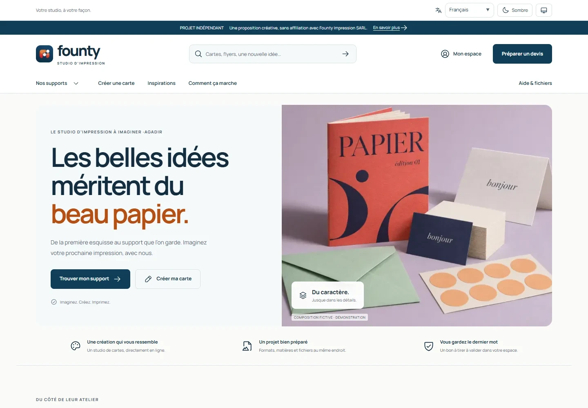
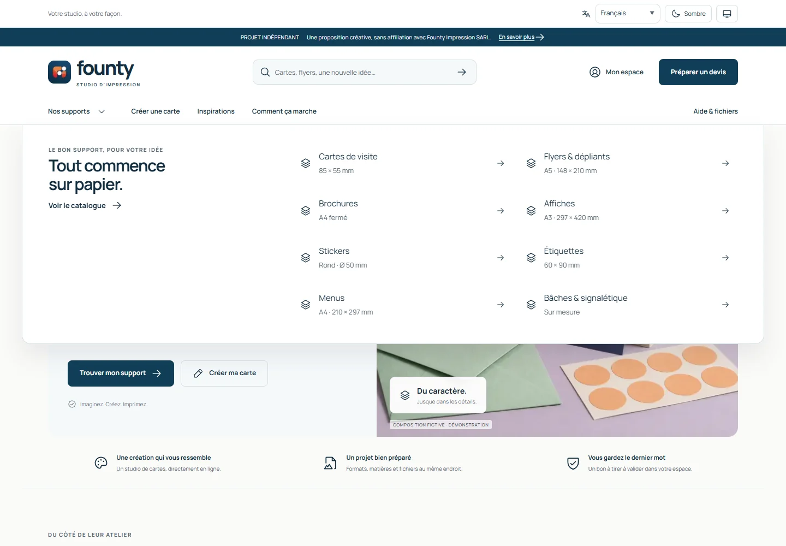
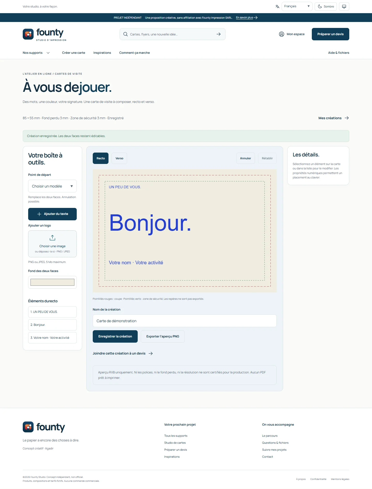
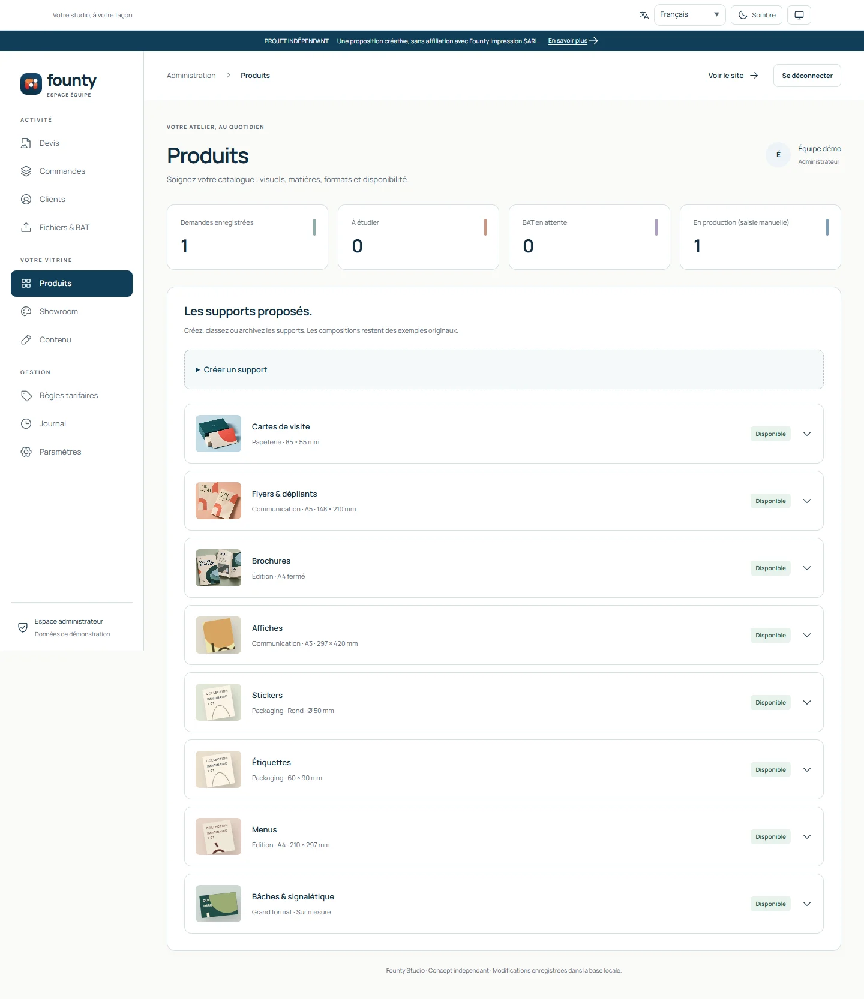

# Founty Studio — aperçu du projet

**Conception et développement : Arrid Driss, développeur web à Agadir.**

Proposition indépendante de plateforme d’impression : catalogue de produits, studio de création, demandes de devis et espace d’administration. Interface responsive en français, anglais et arabe, avec modes clair et sombre.

Ce dépôt présente uniquement des captures d’écran et une courte présentation. **Le code source du site n’est pas publié.**

## Découvrir le projet

- [Galerie complète : pages, menus, onglets et administration](GALLERY.md)
- [Accueil complet](screenshots/01-accueil.webp) · [Version mobile](screenshots/accueil-375.webp)
- [Catalogue](screenshots/02-catalogue.webp) · [Connexion](screenshots/11-connexion.webp) · [Inscription](screenshots/12-inscription.webp)
- [Studio de création](screenshots/studio-recto.webp) · [Demande de devis](screenshots/10-devis.webp)
- [Administration du catalogue](screenshots/admin-produits.webp) · [Éditeur de produit](screenshots/admin-produits-editeur.webp)
- [Accueil sombre](screenshots/accueil-fr-dark.webp) · [Interface arabe RTL](screenshots/accueil-ar-dark.webp)

## Quelques écrans

### Navigation et catalogue

### Studio de création

### Administration

Les captures ont été réalisées dans Chrome sur l’application locale, avec des comptes et des données fictifs. Elles montrent une démonstration du logiciel, pas des commandes ou des productions réelles.

**Projet indépendant, non commandé, non autorisé et non exploité par Founty Impression SARL.** Les images Instagram attribuées à [@fountyimpression.ma](https://www.instagram.com/fountyimpression.ma/) restent distinctes des compositions fictives utilisées pour la démonstration. Voir [les crédits](ATTRIBUTION.md) et [les conditions de présentation](RIGHTS.md).
